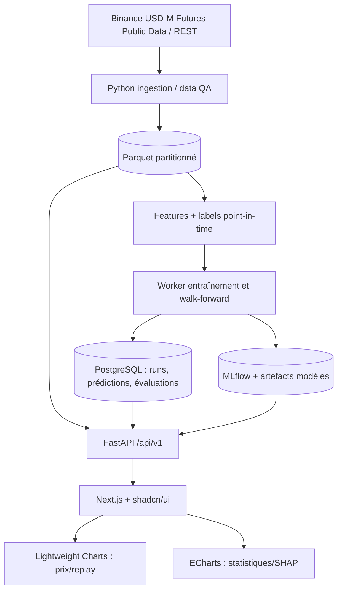

# 01 — Architecture et responsabilité des modules

## Vue système



Le front **ne calcule ni labels, ni features, ni décisions**. Il visualise des données versionnées reçues de l'API. FastAPI ne réalise pas d'entraînement CPU lourd pendant une requête web. Le worker reçoit un `run_id`, lit le dataset et écrit ses artefacts.

## Stack retenue

| Couche | Technologie | Justification |
|---|---|---|
| UI | Next.js App Router + TypeScript, shadcn/ui | Navigation, filtres, composants cohérents |
| Charts | TradingView Lightweight Charts | Chandeliers, séries, marqueurs, synchronisation temporelle |
| Statistiques | Apache ECharts | Matrices, heatmaps, comparaison, calibration |
| API | FastAPI + Pydantic | JSON typé, schéma OpenAPI |
| ML | LightGBM, scikit-learn | Classification multiclasse + baselines |
| Data | Pandas/NumPy, DuckDB, PyArrow/Parquet | Traitement et stockage M5 |
| Persistance | PostgreSQL | Métadonnées, prédictions, historique et statuts |
| Expériences | MLflow | Paramètres, métriques, modèles et lineage |
| Exécution longue | Worker Python dédié ; RQ/Celery ensuite | Isolation des entraînements |

## Structure cible, adaptable au dépôt VS Code existant

```text
cryptoml/
├── frontend/                  # OU app/ à la racine si projet Next.js existant
│   ├── app/
│   ├── components/
│   ├── features/
│   └── lib/api/
├── backend/
│   ├── app/main.py
│   ├── app/api/v1/
│   ├── app/core/
│   ├── app/schemas/
│   ├── app/db/
│   ├── ingestion/
│   ├── data_quality/
│   ├── features/
│   ├── labels/
│   ├── training/
│   ├── validation/
│   ├── evaluation/
│   ├── inference/
│   └── workers/
├── tests/
├── data/raw/                # fichier local, ignoré de git
├── data/processed/          # fichier local, ignoré de git
├── artifacts/               # modèles/rapports, ignoré de git
├── docs/
├── contracts/
└── examples/
```

**Ne pas imposer une restructuration** si le projet Next.js existe déjà : ajouter `backend/`, `docs/`, etc. et adapter les chemins dans le README principal.

## Flux d'une prédiction

1. Le collecteur reçoit les bougies M5 Futures et identifie celles effectivement **clôturées**.
2. Un instant de référence `bar_close_at` est fixé, avec une latence d'accessibilité réaliste `available_at`.
3. Le builder charge les dernières fenêtres de la paire et du contexte BTC/ETH à `available_at` ou avant ; refuse les features incomplètes.
4. L'inférence utilise une **version précise** de modèle et la même définition de features que lors du train.
5. La prédiction et sa distribution sont enregistrées avec les timestamps, la version et un `evaluation_status=PENDING`.
6. Quand `close_{t+H}` est connu, le processus de résolution calcule la classe réalisée ; passage à `MATURED`.
7. L'API expose historique, résultat et métadonnées ; l'UI le visualise sans accès anticipé.

## MVP vs industrialisation

Pour le prototype, un worker local et des fichiers Parquet suffisent. MLflow local possible. PostgreSQL est recommandé dès que les expériences sont pilotées par l'UI ; Redis/RQ/Celery et stockage objet sont des évolutions, **pas des prérequis** pour entraîner le premier modèle.

## Contraintes transverses

- UTC ISO-8601 dans l'API ; timestamps entiers UTC normalisés dans les données.
- API versionnée `/api/v1`, identifiants stables, pagination des historiques.
- Idempotence des imports et des calculs d'évaluation.
- Journalisation et validation Pydantic.
- Pas de lecture d'une bougie en formation, pas de « dernier prix live » considéré comme clôture confirmée.
