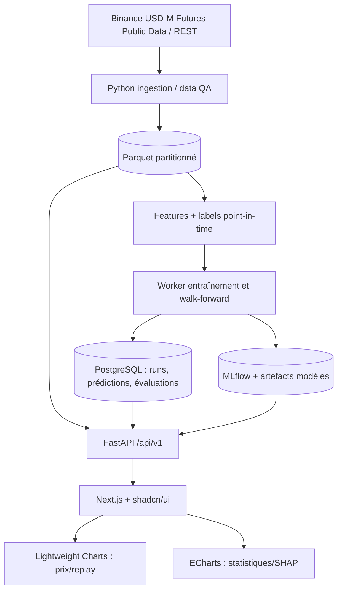

# CryptoML — Spécification complète (version lecture unique)

> Document **généré depuis le dossier Markdown structuré** au 12 octobre 2026. À utiliser pour comprendre le projet dans VS Code ; pour modifier la documentation, privilégier les fichiers séparés de `docs/`.

---

# CryptoML — Documentation produit et technique

> **Statut : spécification cible, pas application déjà développée.** Version 1.0 du dossier — 12 octobre 2026. Langue : français. Éléments d'API et de fichiers proposés à implémenter.

CryptoML est une application de recherche en apprentissage automatique pour **anticiper la direction de marchés crypto perpétuels USDⓈ-M en M5** à partir de données historiques multi-actifs, avec un **modèle global LightGBM**, des évaluations rigoureuses et un **replay visuel « prédit vs réel »**.

**Objectif de la première phase : qualité prédictive, pas profits/trading.** Les fonctionnalités de transactions, d'effet de levier et de PnL restent dans le wireframe mais **ne sont pas au périmètre du MVP prédictif**. Aucun passage d'ordre réel n'est prévu.

## Décisions confirmées

- **Interface** : Next.js, TypeScript, shadcn/ui ; TradingView Lightweight Charts pour chandeliers/courbes temporelles ; ECharts pour statistiques.
- **Backend** : Python et FastAPI. Entraînement asynchrone dans un processus worker indépendant.
- **Modèle** : LightGBM, classification directionnelle **HAUSSE / NEUTRE / BAISSE**.
- **Marché** : contrats perpétuels crypto USDT-M (source initiale Binance Futures), sans exécution.
- **Données** : M5, OHLCV Futures et features relatives ; contexte BTC/ETH lorsque synchronisé et disponible.
- **Généralisation** : un modèle global multi-crypto, initialement sans identifiant de symbole comme feature ; tests sur paires jamais vues.
- **Horizons** : 3, 6 et 12 bougies M5 = 15, 30 et 60 minutes ; un modèle par horizon.
- **Évaluation** : séparation chronologique, purge des labels, walk-forward, holdout symboles, calibration et baselines.
- **Produit** : 11 pages, dont « Qualité prédictive » avec replay prédit vs réel sans trades.

## Cartographie des documents

| Document | Contenu |
|---|---|
| [00 — Produit et périmètre](docs/00_PRODUIT_ET_PERIMETRE.md) | Vision, utilisateurs, objectifs, exclusions |
| [01 — Architecture](docs/01_ARCHITECTURE.md) | Modules, flux, structure du dépôt |
| [02 — Données](docs/02_DONNEES_INGESTION.md) | Sources, schémas, qualité, alignement temporel |
| [03 — Features et labels](docs/03_FEATURES_ET_LABELS.md) | Prédictions M5, règles anti-fuite |
| [04 — Entraînement](docs/04_ENTRAINEMENT_LIGHTGBM.md) | Pipeline ML, paramètres, versionnement |
| [05 — Validation](docs/05_VALIDATION_ET_METRIQUES.md) | Walk-forward et cryptos inédites |
| [06 — API](docs/06_CONTRATS_API.md) | Endpoints et format des réponses |
| [07 — Interface](docs/07_PAGES_ET_COMPOSANTS.md) | Spécification des 11 pages |
| [08 — Replay](docs/08_REPLAY_PREDIT_VS_REEL.md) | Chart, simulation point-in-time, interactions |
| [09 — Persistance](docs/09_STOCKAGE_ET_MODELES.md) | PostgreSQL / Parquet / MLflow |
| [10 — Développement](docs/10_ENVIRONNEMENT_DEV.md) | Installation prévue, configuration, lancement |
| [11 — Tests](docs/11_TESTS_ET_CRITERES_ACCEPTATION.md) | Contrôles unitaires, temporels et UX |
| [12 — Roadmap](docs/12_ROADMAP.md) | Phases et livrables |
| [13 — Décisions](docs/13_DECISIONS_OUVERTES.md) | ADR et choix à confirmer |
| [14 — Glossaire et références](docs/14_GLOSSAIRE_ET_SOURCES.md) | Définitions et documentation officielle |

Également inclus : [maquette V4 validée](references/wireframe_lightgbm_crypto_v4_replay.html), [contrat OpenAPI proposé](contracts/openapi.yaml), [exemples de réponses](examples/), [checklist](TASKS_CRYPTOML.md), [instructions à un assistant de code](AGENTS_CRYPTOML.md), [variables d'environnement exemple](.env.cryptoml.example).

## Installation dans un projet VS Code existant

1. Décompresser le ZIP et copier **`docs/`, `contracts/`, `examples/`, `README_CRYPTOML.md`, `TASKS_CRYPTOML.md`, `AGENTS_CRYPTOML.md`, `.env.cryptoml.example`** à la racine du dépôt (sans écraser d'éventuels fichiers existants).
2. Ouvrir `README_CRYPTOML.md` (aperçu Markdown dans VS Code : `Ctrl+Shift+V`).
3. Commencer par les tâches **P0** dans `TASKS_CRYPTOML.md`.
4. Si tu utilises un agent de développement, lui fournir `AGENTS_CRYPTOML.md`, puis le document relatif à la tâche.

> Le dossier contient **de la documentation et un projet de contrat**, pas un backend opérationnel. Les commandes d'exécution décrites dans la documentation ne seront utilisables qu'une fois les modules implémentés.

## Premier jalon recommandé

Importer **BTCUSDT, ETHUSDT, SOLUSDT, XRPUSDT et ADAUSDT en M5 Futures**, construire les features passées uniquement, entraîner **H=6 / 30 minutes**, générer un rapport de classification hors échantillon et exposer un replay temporel fidèle. Ensuite étendre à H=3/H=12 et aux 20–30 paires.

## Règles non négociables

1. Pas de donnée future dans les features, les transformations, la validation ni le replay.
2. Les valeurs fictives du wireframe ne sont pas des performances mesurées.
3. Un modèle n'est pas « bon » seulement parce qu'il bat le hasard sur le train ; il faut une amélioration hors échantillon par rapport aux baselines.
4. Les données sources, les paramètres, les versions et les prédictions doivent rester traçables.
5. Aucun ordre réel, clé API privée d'exchange ou levier réel pendant la phase prédictive.


---

# 00 — Vision produit, objectifs et limites

## Pourquoi CryptoML ?

Construire une plateforme de **recherche prédictive crypto multi-actifs** qui permet d'apprendre des motifs temporels sur des contrats perpétuels M5, puis de les confronter aux prix réellement observés. L'utilisateur doit pouvoir répondre à :

1. Le modèle anticipe-t-il mieux la direction que des baselines simples ?
2. À quel horizon (15/30/60 min) et sur quels actifs fonctionne-t-il ?
3. Ses probabilités sont-elles fiables et stables dans le temps ?
4. Quels motifs influencent les prédictions et dans quelles conditions échoue-t-il ?
5. Généralise-t-il à une crypto totalement absente des données de développement ?

## Périmètre MVP — Phase prédictive

- Marché des **Futures perpétuels USDT-M** ; premier fournisseur de données : Binance USDⓈ-M.
- Unité de temps : **M5**. 3 horizons distincts H=3, H=6, H=12 bougies.
- Prédiction multiclasses : **UP**, **NEUTRAL**, **DOWN** ; sorties probabilistes.
- Historique multi-crypto : pilote 5 paires, extension ciblée à 20–30 paires liquides.
- Un modèle global sans ID du symbole comme feature au départ ; contexte marché BTC/ETH calculé au même temps.
- Évaluations walk-forward, test final temporel et test final de paires inédites ; visualisation sur chandeliers par replay.
- API interne pour intégrer les évaluations et prédictions à l'application Next.js.

## Hors périmètre MVP

- Passage d'ordres, API privées d'exchange, margin/leverage réels, liquidation, sizing et exécution.
- PnL et backtest de stratégie (pages conservées comme **futures phases**, elles doivent afficher « Non disponible » plutôt que de simuler des résultats réels).
- LLM/Qwen, news et sentiment, modèles deep learning.
- Garantie de prédiction valable sur « toutes » les cryptos, y compris les paires illiquides ou récemment cotées.

## Profils utilisateurs

- **Chercheur/constructeur** : configure et compare données, features, labels, modèles et expériences.
- **Analyste** : examine les matrices de confusion, l'incertitude, le replay et les conditions d'erreur.

## Parcours métier cible

1. Choisir un univers et un intervalle historique ; importer et valider les données.
2. Créer un dataset versionné ; calculer les features/labels sans fuite.
3. Définir horizons et protocole de validation ; lancer un run.
4. Consulter rapports et scores réellement hors échantillon.
5. Cliquer une prédiction ; rejouer le graphique **sans afficher le futur** jusqu'à la maturation du label.
6. Comparer modèles par période, par actif et par classe ; ne promouvoir qu'une version contrôlée.

## Critères de succès — MVP (fonctionnels, pas financiers)

- Sur un jeu de test déterministe, les splits, features, labels et états du replay sont exacts.
- Import des 5 paires pilote avec rapport de qualité et couverture temporelle par symbole.
- Un modèle global H=6 produit des probabilités valides sommant à 1 ; les performances OOS sont mesurées et comparées aux baselines.
- Un résultat de prédiction contient les versions, horodatages, classe attendue et disponibilité du verdict.
- Le replay et la page « Qualité prédictive » utilisent les mêmes identifiants et timestamps que l'évaluation stockée.

## Termes d'interface

- **Prediction/Prévision** = distribution P(UP, NEUTRAL, DOWN) sur un horizon.
- **Classe réelle** = catégorie calculée après disponibilité de la dernière bougie de l'horizon.
- **Signal de trading** = *non fourni dans le MVP*, distinct d'une prévision directionnelle.
- **Backtest de trading** = future phase ; ne pas confondre avec le backtest prédictif hors échantillon.


---

# 01 — Architecture et responsabilité des modules

## Vue système



Le front **ne calcule ni labels, ni features, ni décisions**. Il visualise des données versionnées reçues de l'API. FastAPI ne réalise pas d'entraînement CPU lourd pendant une requête web. Le worker reçoit un `run_id`, lit le dataset et écrit ses artefacts.

## Stack retenue

| Couche | Technologie | Justification |
|---|---|---|
| UI | Next.js App Router + TypeScript, shadcn/ui | Navigation, filtres, composants cohérents |
| Charts | TradingView Lightweight Charts | Chandeliers, séries, marqueurs, synchronisation temporelle |
| Statistiques | Apache ECharts | Matrices, heatmaps, comparaison, calibration |
| API | FastAPI + Pydantic | JSON typé, schéma OpenAPI |
| ML | LightGBM, scikit-learn | Classification multiclasse + baselines |
| Data | Pandas/NumPy, DuckDB, PyArrow/Parquet | Traitement et stockage M5 |
| Persistance | PostgreSQL | Métadonnées, prédictions, historique et statuts |
| Expériences | MLflow | Paramètres, métriques, modèles et lineage |
| Exécution longue | Worker Python dédié ; RQ/Celery ensuite | Isolation des entraînements |

## Structure cible, adaptable au dépôt VS Code existant

```text
cryptoml/
├── frontend/                  # OU app/ à la racine si projet Next.js existant
│   ├── app/
│   ├── components/
│   ├── features/
│   └── lib/api/
├── backend/
│   ├── app/main.py
│   ├── app/api/v1/
│   ├── app/core/
│   ├── app/schemas/
│   ├── app/db/
│   ├── ingestion/
│   ├── data_quality/
│   ├── features/
│   ├── labels/
│   ├── training/
│   ├── validation/
│   ├── evaluation/
│   ├── inference/
│   └── workers/
├── tests/
├── data/raw/                # fichier local, ignoré de git
├── data/processed/          # fichier local, ignoré de git
├── artifacts/               # modèles/rapports, ignoré de git
├── docs/
├── contracts/
└── examples/
```

**Ne pas imposer une restructuration** si le projet Next.js existe déjà : ajouter `backend/`, `docs/`, etc. et adapter les chemins dans le README principal.

## Flux d'une prédiction

1. Le collecteur reçoit les bougies M5 Futures et identifie celles effectivement **clôturées**.
2. Un instant de référence `bar_close_at` est fixé, avec une latence d'accessibilité réaliste `available_at`.
3. Le builder charge les dernières fenêtres de la paire et du contexte BTC/ETH à `available_at` ou avant ; refuse les features incomplètes.
4. L'inférence utilise une **version précise** de modèle et la même définition de features que lors du train.
5. La prédiction et sa distribution sont enregistrées avec les timestamps, la version et un `evaluation_status=PENDING`.
6. Quand `close_{t+H}` est connu, le processus de résolution calcule la classe réalisée ; passage à `MATURED`.
7. L'API expose historique, résultat et métadonnées ; l'UI le visualise sans accès anticipé.

## MVP vs industrialisation

Pour le prototype, un worker local et des fichiers Parquet suffisent. MLflow local possible. PostgreSQL est recommandé dès que les expériences sont pilotées par l'UI ; Redis/RQ/Celery et stockage objet sont des évolutions, **pas des prérequis** pour entraîner le premier modèle.

## Contraintes transverses

- UTC ISO-8601 dans l'API ; timestamps entiers UTC normalisés dans les données.
- API versionnée `/api/v1`, identifiants stables, pagination des historiques.
- Idempotence des imports et des calculs d'évaluation.
- Journalisation et validation Pydantic.
- Pas de lecture d'une bougie en formation, pas de « dernier prix live » considéré comme clôture confirmée.


---

# 02 — Sources de données, schémas et contrôles qualité

## Marché et sources

- Contrats perpétuels **Binance USDⓈ-M**, paires `BTCUSDT`, `ETHUSDT`, etc.
- Archives historiques : https://data.binance.vision/ et dépôt descriptif https://github.com/binance/binance-public-data.
- Complément récent : `GET https://fapi.binance.com/fapi/v1/klines?symbol=BTCUSDT&interval=5m...`.
- Le *funding*, *mark price* et *open interest* sont réservés à une phase ultérieure, sauf disponibilité historique et horodatage fiable ; **ne pas remplir les trous par des valeurs inventées**.

## Import initial

1. Pilote : BTCUSDT, ETHUSDT, SOLUSDT, XRPUSDT, ADAUSDT ; fenêtre historique commune maximale réaliste.
2. Archives mensuelles puis quotidiennes ; vérification des CHECKSUM si proposés.
3. Décompresser et normaliser le schéma ; réconcilier doublons archive/API avec règles documentées.
4. Exclure les bougies non clôturées au moment de l'import/inférence.
5. Identifier trous, timestamps incohérents et données hors marché ; publier rapport qualité.
6. Stocker données **brutes immuables** puis version propre Parquet ; garder checksums/source pour traçabilité.
7. Étendre à 20–30 paires sélectionnées avec liquidité minimale documentée, sans biaiser l'évaluation vers seules paires encore vivantes aujourd'hui.

## Schéma canonique des bougies M5

| Champ | Type | Commentaire |
|---|---|---|
| `exchange` | string | `binance` |
| `market` | string | `usdt_perpetual` |
| `symbol` | string | exemple `BTCUSDT` |
| `timeframe` | string | `5m` |
| `bar_open_at` | datetime UTC | début de la bougie |
| `bar_close_at` | datetime UTC | **borne exclusive** `bar_open_at + 5 minutes` |
| `open`, `high`, `low`, `close` | float positif | OHLC |
| `volume_base`, `volume_quote` | float non négatif | volumes dans les unités explicites |
| `trade_count` | entier | si disponible |
| `taker_buy_volume_base`, `taker_buy_volume_quote` | float | si disponible |
| `source` | string | `archive_monthly`, `archive_daily`, `rest` |
| `ingested_at` | datetime UTC | date import, pas date marché |
| `is_final` | boolean | bougie clôturée et confirmée |

**Convention cruciale** : Binance publie souvent `close_time = open_time + interval - 1 ms`. Dans notre base, `bar_close_at = open_time + interval` représente la **fin logique exclusive**, utilisée pour la disponibilité et le replay. Ne pas confondre ces deux conventions.

## Validations à appliquer par symbole

- Unicité `(exchange, market, symbol, timeframe, bar_open_at)`.
- Alignement exact aux pas de 300 secondes ; ordre strictement croissant.
- `low <= min(open, close)`, `high >= max(open, close)`, `low <= high`.
- Prix strictement positifs ; volumes et trade_count non négatifs.
- Détection des trous (`diff(bar_open_at) != 5min`), doublons, volumes nuls suspects, pics aberrants, changements de listing.
- En cas de trous : marquer période comme inéligible si une fenêtre de features ou de label la traverse ; **pas de forward-fill des bougies OHLC inventées**.
- Documenter les effets de contrats suspendus/délistés et survivorship bias.
- Séries contextuelles BTC/ETH alignées sur la même bougie ; si absentes, l'échantillon concerné est rejeté ou traité par une politique de valeurs manquantes fixée a priori.

## Stockage proposé

```text
data/raw/binance/usdt_perpetual/5m/BTCUSDT/2025-01.zip
data/processed/ohlcv/exchange=binance/market=usdt_perpetual/
    timeframe=5m/symbol=BTCUSDT/year=2025/month=01/part-000.parquet
```

Pour chaque snapshot du dataset, produire un manifest : `dataset_id`, date de construction, intervalle UTC, liste des symboles, schéma, contrôles qualité, hashes et version du code.

## Informations disponibles « point-in-time »

Les données peuvent être connues après leur date de marché. Pour la simulation, vérifier `available_at <= prediction_issued_at`. Ne jamais utiliser un indicateur recalculé a posteriori si sa version n'était pas disponible lors de la prédiction historique. Le MVP peut se limiter à OHLCV clôturé (source moins ambiguë) et enregistrer la latence supposée.

## Hors périmètre de cette phase

Prix de liquidation, exécution, carnet d'ordres historique point-in-time et funding exact par position. Ils deviendront requis pour un futur backtest perpétuel **de trading**, pas pour l'évaluation directionnelle actuelle.


---

# 03 — Features et labels de prévision directionnelle

## Définition temporelle

Pour une paire `s` et une bougie clôturée à l'instant `t` :

- **Features `X(s,t)`** : exclusivement des informations de bougies clôturées au plus tard à `t`, et disponibles lors de l'émission.
- **Close de référence `C_t`** : clôture de la dernière bougie connue.
- **Label H** : prix à la clôture de la **H-ième bougie future** (`C_(t+H)`), avec `H ∈ {3, 6, 12}`.
- **Rendement réalisé** : `r(s,t,H) = C_(t+H) / C_t - 1`.
- `label_mature_at = close_time(t+H)` ; un label n'existe pas avant cet instant.

Ce rendement est une **mesure de marché**, pas un rendement réalisable après exécution. L'entrée sur clôture connue n'est pas utilisée ici comme hypothèse de trading.

## Classes

La cible est `DOWN = 0`, `NEUTRAL = 1`, `UP = 2`. La politique de seuil est versionnée.

Version initiale envisagée : `tau(s,t,H) = k_H * volatility_past(s,t) * sqrt(H)` où `volatility_past` est la déviation standard des rendements M5 sur une fenêtre passée (par exemple 48 bougies), avec garde contre zéros/anomalies. `k_H` est défini sur **train/validation exclusivement**, jamais sur le test final.

- `UP` si `r > +tau` ; `DOWN` si `r < -tau` ; `NEUTRAL` sinon.
- La classe NEUTRAL exprime un mouvement **de faible amplitude**, pas la recommandation `WAIT` d'une stratégie.
- Comparer en ablation : label binaire hausse/baisse, ou seuil fixe en % **fixé sans test leakage**.
- Si distribution des classes très déséquilibrée : vérifier proportion et seuil, ne pas interpréter une accuracy brute élevée comme succès.

**Attention** : une alternative « mouvement significatif touché au cours de H » utilisant high/low et barrières est une autre cible, à spécifier séparément. Le MVP vise uniquement `close à horizon fixe`.

## Features candidates (point de départ, à ablater)

| Groupe | Features | Fenêtres M5 |
|---|---|---|
| Rendements | `ret_1`, `ret_3`, `ret_6`, `ret_12`, `ret_24`, `ret_48` | 5 min → 4h |
| Volatilité | `std_ret_12`, `std_ret_48`, `atr_pct_14` | 1h, 4h, 70min |
| Tendance | `close/ema_12-1`, `close/ema_48-1`, `ema_12/ema_48-1` | 1h, 4h |
| Oscillateur | `rsi_14` | 70min |
| Structure | `body_pct`, `range_pct`, `upper_wick_pct`, `lower_wick_pct`, `close_position` | bougie actuelle clôturée |
| Volume | `volume_quote_rel_12`, `volume_quote_rel_48`, `taker_buy_share` | historique exclusivement |
| Contexte | `btc_ret_3`, `btc_ret_12`, `eth_ret_3`, `eth_vol_12` | mêmes horodatages |
| Saisonnalité | `sin/cos(hour_utc)`, `sin/cos(weekday)` | date connue |

Débuter avec **15–25 features validées** puis enrichir. Éviter les prix absolus comme unique signal de l'identité d'une crypto ; privilégier pourcentages et ratios. Des features de liquidité en USDT pourront être ajoutées comme ablation contrôlée.

## Formules exemplaires

```python
# Hypothèse : données triées par (symbol, bar_close_at).
# Transformations par paire, JAMAIS rolling global mélangeant les actifs.
g = df.groupby('symbol', sort=False)
df['ret_6'] = g['close'].pct_change(6)
df['ema_48'] = g['close'].transform(lambda s: s.ewm(span=48, adjust=False).mean())
df['distance_ema_48'] = df['close'] / df['ema_48'] - 1

# Calcul du futur UNIQUEMENT pour créer la cible / l'évaluation :
for h in (3, 6, 12):
    future_close = g['close'].shift(-h)
    df[f'future_return_{h}'] = future_close / df['close'] - 1
    # label_mature_at = g['bar_close_at'].shift(-h)
```

Dans l'implémentation réelle, vérifier qu'aucune discontinuité de temps ne traverse la fenêtre de calcul, même si les lignes suivantes existent. Les features BTC/ETH doivent être jointes par timestamp sans interpolation future.

## Contrat de features

Artefact `feature_schema.json` : noms ordonnés, types, unités, fenêtres, politique NaN, versions des calculs, contexte exigé, timezone et timestamp d'émission. Le même builder et la même version sont utilisés pour train, test et inférence.

## Interdictions et contrôles

- Jamais de `.shift(-n)` dans les features ; réserver le décalage négatif aux labels.
- Aucun scaler/global encoder appris sur des données de validation ou test.
- `future_return`, `actual_class`, `label_mature_at`, informations postérieures et `symbol` identifiant sont interdits dans `X` initial (symbol reste une **clé de jointure**).
- Fenêtre d'indicateurs incomplète → sample marqué `not_eligible`, pas de remplissage par futur.
- Unit tests : modifier tous les futurs après `t` ne doit **jamais** changer `X(s,t)` ni la probabilité prédite pour un modèle figé.


---

# 04 — Entraînement LightGBM multi-crypto

## Modèles

- Trois `LGBMClassifier(objective='multiclass')` globaux distincts : `h3`, `h6`, `h12`.
- Labels de classes `{0: DOWN, 1: NEUTRAL, 2: UP}`.
- Même schéma de features sur tous les actifs ; `symbol` absent de `X` en V1, conservé pour métriques et splits.
- Baselines : classe majoritaire train, persistance du signe du rendement récent avec gestion explicite du neutre, régression logistique régularisée.

## Pipeline d'un run

1. Référencer un `dataset_id` gelé, `feature_schema_version`, `label_config_id` et univers de symboles.
2. Extraire toutes les samples éligibles et trier chronologiquement.
3. Construire un split temporel avec paires train/validation/test définies **avant** entraînement.
4. Purger les samples dont les `label_mature_at` tombent dans la période suivante ; prévoir aussi un embargo si nécessaire.
5. Calculer les statistiques de traitement manquant/normalisation strictement sur train. LightGBM ne requiert pas de scaling systématique.
6. Entraîner les modèles par horizon ; utiliser `early_stopping` sur la validation propre au fold.
7. Générer prédictions OOS + métriques + classes + SHAP/importance des features + manifests.
8. Sauvegarder modèle, seed, hyperparamètres, version environnement, commit Git et métriques dans MLflow.
9. **Ne jamais améliorer les hyperparamètres en fonction du score du test final.**

## Paramètres de départ (à ajuster sur validation uniquement)

```yaml
model: lightgbm_multiclass
objective: multiclass
n_estimators: 800
learning_rate: 0.03
num_leaves: 31
max_depth: -1
min_child_samples: 150
subsample: 0.8
subsample_freq: 1
colsample_bytree: 0.8
reg_alpha: 0.1
reg_lambda: 1.0
random_state: 42
early_stopping_rounds: 50
```

Ces valeurs sont **hypothèses de départ**, pas hyperparamètres validés. Tester des modèles plus simples et le coût en mémoire. Ne pas utiliser le dernier fold comme validation après avoir vu son résultat final.

## Équilibrage multi-crypto

Les 20–30 paires peuvent avoir des durées d'historique différentes et des volatilités très variées. Évaluer une pondération symboles/périodes calculée sur train, sans pénaliser arbitrairement les nouvelles paires. Reporter à la fois **métrique agrégée** et **métriques par symbole**.

## Reproductibilité

Chaque run doit persister :

```text
run_id, horizon_bars, universe_id, dataset_id,
feature_schema_version, label_config_id, splits_manifest_id,
model_family, hyperparameters, random_state,
training_started_at, training_finished_at, git_commit,
artifacts_path, run_status
```

Les prédictions OOS stockées sont associées au **run/fold** qui les a produites et ne doivent jamais être recalculées a posteriori avec un modèle plus récent puis présentées comme historiques.

## Statuts job

`QUEUED → RUNNING → EVALUATING → COMPLETED`, ou `FAILED`, `CANCELLED`. Le frontend suit la progression, les étapes et les logs filtrés ; un échec doit garder message technique et trace sans divulguer de secrets.


---

# 05 — Walk-forward, généralisation et métriques

## Pourquoi deux axes de validation ?

- **Généralisation temporelle** : les mêmes paires sur des périodes ultérieures inconnues.
- **Généralisation cross-asset** : des paires intégralement exclues du **développement** du modèle et des réglages.

Les deux sont nécessaires pour soutenir la promesse « adaptable à une nouvelle paire ». Cela ne garantit pas que toutes les paires futures seront prévisibles.

## Protocole recommandé

1. Fixer dès le début un **test final temporel** (derniers 3–6 mois selon couverture et besoin) et **un groupe de paires test final** inconnu du train/validation.
2. Sur le reste des dates et paires autorisées : walk-forward glissant (exemple initial 120 jours train, 14 jours validation, 14 jours test OOS, pas de 14 jours). Les fenêtres sont des paramètres expérimentaux, pas des vérités absolues.
3. Les paramètres et le seuil de label sont sélectionnés exclusivement au moyen du train et de la validation des folds de développement.
4. Avant tout split : pour un sample (symbole, temps t, horizon H), calculer `label_mature_at`. L'exclure du train si `label_mature_at >= validation_start`. Appliquer l'équivalent à la séparation validation → test ; vérifier les dépendances temporelles des variables.
5. Préserver des intervalles de **test chronologiquement disjoints** afin de ne pas compter plusieurs fois les mêmes événements.
6. Produire métriques **par fold, horizon, crypto, classe et régime**, puis agrégations robustes.
7. Utiliser le test final **une fois après gel des choix**, et archiver le rapport.

### Attention aux corrélations

BTC/ETH/SOL peuvent réagir au même événement ; des millions d'échantillons M5 chevauchants ne sont pas indépendants. Estimer l'incertitude avec des méthodes temporelles (ex. bootstrap par blocs ou par périodes) et rapporter nombres de journées/semaines et paires, pas seulement lignes.

## Métriques principales (3 classes)

| Métrique | Pourquoi | Précaution |
|---|---|---|
| Balanced Accuracy | Rappel moyen des classes | Plus informative qu'accuracy brute si classes inégales |
| Macro F1 | Précision/rappel équilibrés | Reporter support des classes |
| Matrice de confusion | Erreurs UP/NEUTRAL/DOWN | Réel en lignes, prédit en colonnes ; effectifs + pourcentages |
| Log loss | Qualité probabiliste multiclasses | Sensible à la surconfiance |
| Brier multiclasses | Écart au vecteur one-hot réel | Bien définir la convention de somme des carrés |
| Calibration | Fiabilité des probabilités | Courbes par classe + effectifs des bins |
| Performance par crypto/horizon | Robustesse | Afficher tailles d'échantillon et période |

En complément : accuracy, rappel UP/DOWN, distribution des probabilités, quantiles d'incertitude et sensibilité au seuil neutre. **Éviter AUC binaire seule comme métrique du modèle multiclasses** ; si AUC OVR, expliquer la méthode.

## Baselines, indispensables

- Classe majoritaire apprise sur train uniquement.
- Persistance directionnelle simple (mouvement récent → prévision selon une règle fixe et publique).
- Régression logistique multiclasses régularisée.
- Pour l'accuracy, tenir compte de la proportion des classes ; **33 % n'est pas nécessairement la référence du dataset**.

## Seuils de validation

Ne pas fixer un « score magique » de succès. Un modèle est candidat s'il apporte une amélioration OOS reproductible vs baselines, que la calibration est acceptable, que les performances par paire/régime ne s'effondrent pas et que l'incertitude est documentée. Une performance faible doit pouvoir être acceptée comme résultat scientifique.

## Rapports de validation

- `metrics.json` : métriques agrégées et par fold/crypto/classe.
- `confusion_matrix.json` : matrice et supports.
- `calibration.json` : calibration par classe/bin + tailles.
- `oos_predictions.parquet` : prédictions **au moment du fold**, sans fuite.
- `folds_manifest.json` : dates train/validation/test et exclusions, paires.
- `comparisons.json` : baselines, horizons, modes avec/sans contexte BTC/ETH.

La page « Qualité prédictive » doit séparer visuellement **train**, **validation**, **walk-forward OOS**, **test final temporel**, et **paires inédites**.


---

# 06 — API FastAPI : ressources et conventions

**Statut : contrat cible à implémenter.** Source machine lisible : [`../contracts/openapi.yaml`](../contracts/openapi.yaml). Base locale proposée : `http://localhost:8000/api/v1` ; docs FastAPI : `/docs`.

## Conventions

- JSON et UTF-8 ; `snake_case` ; timestamps UTC ISO-8601 avec `Z` ; horizon exprimé en **nombre de bougies**.
- `symbol` au format fournisseur (`SOLUSDT`), `market=usdt_perpetual`, `timeframe=5m`.
- Réponses paginées `items`, `next_cursor`, `total` facultatif. Tri par défaut ascendant pour chandeliers, décroissant pour prédictions.
- Chaque prédiction historique a un `model_version`, un `run_id`, `feature_schema_version`, `bar_close_at`, `prediction_issued_at`, `label_mature_at`.
- Statut vérité : `PENDING` / `MATURED` / `UNAVAILABLE` ; `actual_class=null` tant que verdict indisponible.
- Erreurs : JSON `{ "error": { "code": "...", "message": "...", "request_id": "..." } }` ; bons codes HTTP 400, 404, 409, 422, 429, 500.
- Les endpoints `POST` d'entraînement/évaluation sont réservés aux utilisateurs authentifiés une fois l'application exposée sur réseau.

## Endpoints recommandés

| Méthode | Route | Réponse / but |
|---|---|---|
| GET | `/health` | disponibilité basique |
| GET | `/api/v1/markets/symbols` | liste des paires éligibles et couverture |
| GET | `/api/v1/market/candles` | OHLCV pour Lightweight Charts |
| GET | `/api/v1/datasets` | datasets et qualité |
| GET | `/api/v1/datasets/{dataset_id}/quality` | trous, volumes, couverture |
| POST | `/api/v1/training-runs` | créer un run, renvoyer 202 + `run_id` |
| GET | `/api/v1/training-runs/{run_id}` | statut/progression/artefacts |
| GET | `/api/v1/models` | modèles versionnés par horizon |
| GET | `/api/v1/evaluations/{evaluation_id}` | métriques, confusion, calibration, breakdown |
| GET | `/api/v1/predictions` | filtrer historique OOS ou inférence |
| GET | `/api/v1/predictions/latest` | dernière prédiction d'un symbole/horizon/modèle |
| GET | `/api/v1/replay` | chandeliers jusqu'au curseur, prédictions éligibles, verdicts matures |
| GET | `/api/v1/explanations/{prediction_id}` | explications SHAP stockées |

### Requête d'entraînement

```http
POST /api/v1/training-runs
Content-Type: application/json
```

```json
{
  "dataset_id": "ds_pilot_001",
  "feature_schema_version": "features_v1",
  "label_config_id": "vol_scaled_v1",
  "horizons": [3, 6, 12],
  "model_family": "lightgbm",
  "validation_protocol": "purged_rolling_walk_forward_v1"
}
```

Réponse `202` :

```json
{ "run_id": "run_20261012_001", "status": "QUEUED" }
```

### Réponse de prédiction

```json
{
  "prediction_id": "pred_001",
  "symbol": "SOLUSDT",
  "market": "usdt_perpetual",
  "timeframe": "5m",
  "bar_close_at": "2026-08-01T12:00:00Z",
  "prediction_issued_at": "2026-08-01T12:00:02Z",
  "model_version": "lgbm_h6_v1",
  "run_id": "run_001",
  "feature_schema_version": "features_v1",
  "horizon_bars": 6,
  "probabilities": {"up": 0.62, "neutral": 0.21, "down": 0.17},
  "predicted_class": "UP",
  "label_mature_at": "2026-08-01T12:30:00Z",
  "evaluation_status": "PENDING",
  "actual_class": null,
  "actual_return": null,
  "demo": true
}
```

Données **purement fictives** ; `demo=true` signifie que cette sortie ne doit jamais être agrégée comme une mesure réelle. Pour des événements historiques de walk-forward, `prediction_issued_at` représente le timestamp **simulé** d'émission ; conserver séparément le moment où le résultat a été produit par le pipeline de recherche si utile.

## Détails de `GET /api/v1/market/candles`

Paramètres requis : `symbol`, `from`, `to` (UTC), optionnels `timeframe=5m`, `limit`. Retour : `[{time,open,high,low,close,volume}]` avec `time` en **secondes UNIX de début de bougie** attendu par Lightweight Charts ; sinon utiliser le contrat `bar_open_at` + adaptateur frontend explicite. Ne pas mélanger seconde et milliseconde.

## Détails de `GET /api/v1/replay`

Paramètres : `evaluation_id`, `symbol`, `horizon_bars`, `cursor_at`, fenêtre visible et limite. Le serveur applique :

- pas de bougie dont `bar_close_at > cursor_at` ;
- pas de prédiction dont `prediction_issued_at > cursor_at` ;
- pas de vérité terrain si `label_mature_at > cursor_at` ;
- ne montrer que les prédictions appartenant à l'évaluation OOS sélectionnée.

Ce filtrage doit être **côté serveur**, pas seulement masqué en CSS/JS.

## Évolutions (hors MVP)

WebSocket/SSE pour statut d'entraînement, génération périodique de prédictions, gestion des tests de stratégie/transactions, calcul d'incertitude en ligne. Ne pas implémenter d'API de trading live dans cette phase.


---

# 07 — Frontend Next.js / shadcn/ui : les 11 pages

Le wireframe V4 est la référence d'ergonomie. Le frontend cible : **Next.js App Router + TypeScript + shadcn/ui + Tailwind CSS**, graphiques **TradingView Lightweight Charts** pour prix/séries chronologiques et **ECharts** pour statistiques de modèle.

## Navigation et écrans

| N° | Page | Objectif et composants | Phase |
|---|---|---|---|
| 1 | **Vue d'ensemble** | KPIs de qualité prédictive OOS, tendances de score, couverture dataset, état modèle | MVP |
| 2 | **Qualité prédictive** | matrice de confusion, macro-F1, balanced accuracy, log loss, calibration, comparaison horizons, par crypto, **replay prédit vs réel sans trade** | MVP PRIORITAIRE |
| 3 | **Graphique & Trades** | chandeliers, marqueurs long/short/sorties, journal PnL, TP/SL | Futur : simulation de stratégie ; état explicite « à venir » |
| 4 | **Signaux** | prévisions UP/NEUTRAL/DOWN, horodatage, fraîcheur, historique et verdicts | MVP, sans conseil/ordre |
| 5 | **Interprétation** | importance globale des features, SHAP local, erreurs et régimes, effectifs | MVP après premiers runs |
| 6 | **Entraînement** | univers, dataset, features, labels, horizons, hyperparamètres, progression | MVP |
| 7 | **Walk-forward** | fenêtres train/val/test, purge, stabilité, holdouts paires inédites | MVP |
| 8 | **Données** | sources, couverture temporelle, trous, doublons, fraîcheur, qualité, symboles | MVP |
| 9 | **Expériences** | runs, versions, baselines, artefacts, comparaison par horizon | MVP |
| 10 | **Backtesting** | equity, PnL, frais, DD, comparaisons stratégies | Futur : non prioritaire ; afficher indisponible |
| 11 | **Paramètres** | exchange public, timeframe, timezone, chemins API et préférences UI | MVP |

**Principe produit** : la page « Qualité prédictive » décrit **les mouvements de marché**, tandis que « Graphique & Trades » et « Backtesting » concernent **des décisions de trading**, qui ne doivent pas être confondues.

## Composants UI réutilisables

```text
components/
  app-shell/sidebar
  global-filters (symbol, horizon, dataset, run, evaluation, segment)
  model-status-badge (training, OOS, demo, unseen-pair)
  metric-card / metric-trend / confidence-interval
  candle-chart / prediction-marker / synchronized-crosshair
  prediction-replay-controller (play, pause, step, speed, reset)
  prediction-inspector (probabilités, classe, maturation, étiquette)
  confusion-matrix / horizon-comparison / calibration-plots
  dataset-quality-grid / experiment-table
  loading-empty-error-states
```

## Filtres globaux

- Marché `usdt_perpetual` (défaut), exchange `binance`, timeframe `5m` (fixé dans le MVP).
- Symbole, horizon H3/H6/H12, période UTC, `model_version`, `run_id` et **segment d'évaluation**.
- Segment visible sur chaque graphique : train/val OOS/test final/paires inédites/démo. Ne pas agréger ces segments par défaut.
- Tous les écrans affichent clairement `Dernière donnée clôturée`, `Modèle`, `Horizon`, `Source`, `OOS vs train`.

## Graphiques

- **Lightweight Charts** : prix OHLC, sous-chart probabilités P(UP/NEUTRAL/DOWN), scores/charts temporels éventuellement synchronisés ; le replay pilote un unique `cursor_at`.
- **ECharts** : confusion, répartition des classes, bars horizon, heatmap symboles, calibration multi-classes, feature importance, SHAP.
- N'utiliser les marqueurs achat/vente **que dans les pages de trading futures** ; sur la page prédictive, marqueurs de **prévision** avec tri-classe.

## États et accessibilité

- États `loading`, `no-data`, `dataset-invalid`, `training-running`, `pending-label`, `model-not-ready`, `API-error`.
- Textes explicites (pas uniquement vert/rouge), navigation clavier, tooltips descriptifs, labels et contraste accessibles.
- Mobile : filtres en tiroir, graph occupent toute la largeur, panneaux inspecteur empilés sous le chart.
- Une métrique affichée doit mentionner son **échantillon, sa période et son segment**.

## API / frontend

Consommer un client typé dérivé de `contracts/openapi.yaml` si possible. Centraliser cache, erreurs, délais et fetch. Le frontend n'a pas accès aux données futures « brutes » en mode replay. Conserver l'identifiant sélectionné dans l'URL pour partager un état, sans y inclure de secret.


---

# 08 — Replay « Prédit vs Réel » : spécification fonctionnelle

## Finalité

Examiner la qualité d'anticipation **sans trade**. Rejouer les bougies M5 d'un actif, afficher uniquement les prévisions qu'un modèle aurait pu émettre, puis révéler le résultat réel à maturité de l'horizon.

## Éléments du panneau

1. **Chart principal** : chandeliers M5 du perp choisi ; marqueur `UP` vert, `DOWN` rouge, `NEUTRAL` gris à la bougie de référence.
2. **Chart probabilités** : séries P(UP), P(NEUTRAL), P(DOWN) alignées sur timestamps de prédiction, sans point futur.
3. **Contrôles replay** : Play/Pause, pas de +1/-1 bougie, vitesse, retour, curseur temporel, saut à prédiction, reset.
4. **Inspecteur** : heure d'émission, modèle/fold, H, probabilités, classe prédite, classe réelle **si disponible**, rendement réel **si mature**, résultat correct/incorrect et facteurs explicatifs.
5. **Liste/timeline des prévisions** : événements émis à une date <= `cursor_at` ; un clic sélectionne l'événement en conservant les restrictions temporelles.
6. **Options** : chandeliers/courbe, affichage des marqueurs, segment OOS, comparaison multi-horizons facultative (après MVP).

## États temporels

| État | Condition | UI |
|---|---|---|
| `NOT_ISSUED` | `prediction_issued_at > cursor_at` | prévision invisible |
| `PENDING` | prédiction émise, mais `label_mature_at > cursor_at` | probas visibles ; verdict masqué |
| `MATURED` | `label_mature_at <= cursor_at`, données complètes | vraie classe/rendement visibles, succès/erreur |
| `UNAVAILABLE` | horizon manquant/invalidé | absence de verdict avec explication |

**Règle absolue :** l'API replay n'envoie aucune bougie dont la clôture est postérieure au curseur. Le frontend applique aussi le filtrage pour l'UX, mais le backend doit le garantir. Un modèle prédit à l'instant `t` n'a pas accès aux bougies `t+1...`.

## Cas particulier : prévisions OOS historiques

Dans un backtest prédictif, le modèle d'un fold est entraîné **avant** le début du segment OOS. Chaque prévision doit pointer vers `evaluation_id`, `fold_id` et `model_version` qui existaient à cette date simulée. Ne jamais calculer des prévisions « historiques » avec un modèle entraîné sur ces mêmes observations puis les présenter comme OOS.

## Chronologie exemple

```text
12:00 — bougie de 11:55–12:00 clôturée, disponible après latence.
12:00:02 — modèle H6 émet P(UP)=0.62, P(NEUTRAL)=0.21, P(DOWN)=0.17.
12:05 — replay avance : nouvelle bougie visible, verdict H6 reste PENDING.
12:25 — dernière bougie visible à 12:25, verdict toujours PENDING.
12:30 — clôture H6 disponible : comparer close(12:30) / close(12:00)-1.
12:30:02 — verdict mature et devient consultable (selon latence de données).
```

Cette convention suppose qu'une bougie `12:00` est nommée par **son instant de fin**, la convention `bar_close_at` décrite dans le contrat.

## Critères d'acceptation

- Pause à 12:10 : aucune bougie close après 12:10, aucun verdict d'une prévision 12:00/H6.
- Déplacement vers une prédiction future : elle reste masquée si son émission dépasse `cursor_at`, sauf choix explicite de déplacement du curseur.
- Reculer le replay **masque à nouveau** les verdicts devenus immatures.
- Passer H3→H6 met à jour toutes les prévisions/verdicts selon le nouvel horizon ; conserver l'indicateur de date et le symbole.
- Cliquer une prédiction erronée l'affiche avec sa situation d'époque et ses features de l'époque, sans explication fabriquée après coup.
- Sur mobile, contrôles de lecture accessibles et graphiques synchronisés sans fuite de données.

## Implémentation technique

Un `ReplayState` minimal : `{evaluation_id, symbol, horizon_bars, cursor_at, playing, speed, selected_prediction_id}`. Une requête `/api/v1/replay` retourne uniquement les objets autorisés au curseur. L'interface affiche `DEMO` si les séries sont synthétiques et `OOS` si elles proviennent d'une évaluation hors échantillon.


---

# 09 — Stratégie de persistance et versionnement

## Trois catégories de données

1. **Parquet** : historique M5 brut/nettoyé, features et prédictions OOS volumineuses ; lecture analytique via DuckDB.
2. **PostgreSQL** : inventaire des datasets, modèles, expériences, splits, jobs, résultats agrégés, références de prédictions et horodatages ; API paginée.
3. **MLflow / artefacts** : modèle LightGBM, manifest d'entraînement, courbes de calibration, confusion, schéma des features et métriques détaillées.

Il est inutile de dupliquer plusieurs années d'OHLCV en Postgres pour le MVP si Parquet/DuckDB dessert correctement le replay. Les références SQL doivent contenir paths/checksums/version.

## Tables relationnelles proposées

| Table | Champs / clés principaux |
|---|---|
| `datasets` | `dataset_id`, `source`, `schema_version`, `start_at`, `end_at`, `checksum`, `created_at` |
| `dataset_symbols` | `(dataset_id, symbol)`, `coverage_start`, `coverage_end`, `missing_bars`, `is_eligible` |
| `feature_sets` | `feature_schema_version`, `schema_json`, `code_ref`, `created_at` |
| `label_configs` | `label_config_id`, `horizons`, `threshold_method`, `params_json` |
| `training_runs` | `run_id`, dataset_id, feature/version, label_config, params, status, started/finished |
| `validation_folds` | `fold_id`, `run_id`, time boundaries, purging, heldout_symbols |
| `model_versions` | `model_version`, `run_id`, `horizon_bars`, `artifact_uri`, `status` |
| `evaluations` | `evaluation_id`, `run_id`, `segment`, metrics, sample_count, start/end |
| `predictions` | `prediction_id`, `evaluation_id`, `fold_id`, `model_version`, `symbol`, `bar_close_at`, `prediction_issued_at`, `horizon_bars`, `up/neutral/down`, `predicted_class`, `label_mature_at`, `evaluation_status`, `actual_class`, `actual_return`, `demo` |
| `jobs` | `job_id`, `kind`, `run_id`, `status`, `progress`, `error_code`, `created_at`, `updated_at` |

## Index importants

- Bougies (Parquet) partitionnées par symbole/date, puis filtrées par range UTC.
- `predictions(symbol, horizon_bars, bar_close_at)`.
- `predictions(evaluation_id, bar_close_at)`.
- `training_runs(created_at desc)` et `model_versions(horizon_bars, status)`.
- Idempotence des prédictions : contrainte de cohérence `(evaluation_id, fold_id, symbol, horizon_bars, bar_close_at)` pour un résultat OOS donné, avec `model_version` correspondant.

## Distinction des dates

- `bar_open_at` et `bar_close_at` : événement de marché.
- `prediction_issued_at` : disponibilité simulée/réelle de la prévision.
- `label_mature_at` : date à laquelle la vérité peut être calculée.
- `generated_at` : instant où un batch de recherche a été calculé (peut être postérieur à la période simulée).
- `created_at` DB : date d'enregistrement de l'artefact.

Cette distinction évite de confondre **quand une donnée a été produite lors du backtest** et **quand elle aurait été connaissable sur le marché**.

## Gouvernance des modèles

Statuts proposés : `EXPERIMENTAL`, `VALIDATED_OOS`, `ARCHIVED`. Le passage à `VALIDATED_OOS` exige un rapport complet et ne signifie pas « profitable ». Stocker une référence immuable aux features, données, labels et code du run. Garder reproductibilité, tests d'intégrité et procédure de rollback.


---

# 10 — Environnement de développement, configuration et exploitation

> **Attention :** ces commandes décrivent une **cible à implémenter**. Le ZIP de documentation **ne contient pas** les modules Python/Next.js ni un `docker-compose.yml` fonctionnel. Adapter à la structure réelle de ton dépôt VS Code.

## Versions et outils (à figer à l'implémentation)

- Node.js LTS compatible avec la version de Next.js installée, TypeScript, gestionnaire npm/pnpm existant.
- Python 3.11+ sous environnement virtuel ; gestion des dépendances via `pyproject.toml` (uv/Poetry ou pip, choix à documenter).
- FastAPI, Uvicorn, Pydantic, Pandas, NumPy, PyArrow, DuckDB, scikit-learn, LightGBM, MLflow, SHAP, pytest.
- PostgreSQL si l'application propose déjà des expériences et données API persistantes.

Ne pas inscrire de numéros de version arbitraires : verrouiller les versions réellement compatibles dans les lockfiles et enregistrer `pip freeze`/commit par run.

## Plan de lancement local prévu

```bash
# Lorsque le backend et ses dépendances auront été créés :
cd backend
python -m venv .venv
# activation selon ton système
pip install -e '.[dev]'
uvicorn app.main:app --reload --host 127.0.0.1 --port 8000

# Dans un autre terminal, lorsque le frontend existe :
cd frontend    # ou la racine du Next.js existant
npm install
npm run dev
```

API cible : `http://localhost:8000/docs` ; Next.js : `http://localhost:3000`. Si le projet existant utilise `src/app`, `pnpm` ou des chemins différents, conserver ses conventions.

## Configuration

Modèle fourni à la racine : `.env.cryptoml.example`. Ajouter les valeurs à l'environnement du backend, jamais dans des composants frontend :

- `DATABASE_URL` : SQL local (seulement si DB activée).
- `DATA_ROOT` : répertoire local de Parquet.
- `ARTIFACTS_ROOT` : modèles/rapports.
- `MLFLOW_TRACKING_URI` : tracking local.
- `CORS_ORIGINS` : origins autorisées, par exemple `http://localhost:3000`.
- `BINANCE_FAPI_BASE_URL` : endpoint de marché public ; pas de clé privée d'exchange.

Variables préfixées `NEXT_PUBLIC_` sont **publiques dans le navigateur** ; ne jamais y stocker des secrets.

## Observabilité

- Logs JSON contenant `request_id`, `run_id`, `dataset_id` ; horodatages UTC.
- Métriques ingestion (bougies, erreurs, délais) et jobs (statut, durée, échecs).
- Une prévision doit être identifiable depuis le replay jusqu'à la version et au fold du modèle.

## Sécurité et contraintes

- Ne jamais exposer un serveur de développement sans contrôle d'accès.
- En production, authentifier `training-runs` et protéger ressources lourdes par quotas/rate-limit.
- Vérifier chemins de fichiers : empêcher path traversal lors d'accès aux artefacts.
- Les données d'exchange utilisées ici sont publiques ; ne pas demander de credentials de trading.
- Pas d'ordre live. Toute extension future exigerait une revue sécurité/risk management séparée.

## Première démonstration réussie

1. 5 paires M5 chargées sans anomalies bloquantes.
2. 1 modèle H6 entraîné sur historique propre et métriques OOS persistées.
3. `/health`, `/market/candles`, `/evaluations/{id}`, `/replay` fonctionnels.
4. La page « Qualité prédictive » affiche les vraies données, avec badges `OOS`, périodes, dates et sample count ; le mode replay ne voit pas le futur.


---

# 11 — Stratégie de tests et critères d'acceptation

## Tests unitaires data

- Normalisation des timestamps Binance : intervalle M5, `bar_close_at` exclusif, conversion millisecondes/secondes.
- Dédoublonnage archive + REST idempotent.
- Détection de trous de 5 min, d'OHLC invalides et de bougies non clôturées.
- Rejet d'une fenêtre de features/label traversant un trou.
- Séparation des calculs par `symbol` : une variation BTC ne doit pas altérer un indicateur historique SOL hors features contextuelles prévues.

## Tests anti-fuite (bloquants)

1. Construire `X(s,t)` sur un jeu connu. Modifier toutes les bougies `>t` : **X(s,t) reste identique**.
2. La feature `close/ema` n'utilise pas une moyenne centrée ni des futures ; `taker_buy` de la bougie en cours uniquement après clôture.
3. Aucun `label`, `future_return` ni timestamp futur n'est présent dans `X`.
4. Le builder multi-timeframe ne joint jamais une bougie H1 partiellement formée.
5. Purge : tous les samples train satisfont `label_mature_at < validation_start` (selon le contrat de borne retenu) et de même pour validation/test.
6. Test final et paires inédites n'influencent jamais selection d'hyperparamètres/seuil.
7. L'égalité des schémas de features entre train et inférence est vérifiée au chargement modèle.

## Tests évaluation

- Probabilités finies, dans `[0,1]` et somme de 1 à tolérance flottante.
- Classes correctement encodées `DOWN=0, NEUTRAL=1, UP=2`.
- Confusion matrix avec lignes vrai, colonnes prédit ; effectifs et supports cohérents.
- Macro F1, balanced accuracy, log loss et Brier calculés vs un fixture connu.
- Scores rapportés par horizon, fold, crypto, segment OOS et avec nombre d'observations.
- Aucune période OOS dupliquée dans un agrégat final.
- Cas monoclasse détecté et métrique impossible indiquée « indisponible » plutôt que faux 0/100 %.

## Tests API

- Pydantic rejette symboles inconnus, horizons invalides, `from > to`, très grandes plages sans pagination.
- `POST training-runs` retourne 202 et un ID ; transition job cohérente, statut erreur explicite.
- API retourne UTC ISO Z ; adaptateur chart gère timestamps en secondes.
- Contrat OpenAPI validé en CI, tests de contrat contre les exemples JSON.
- Cache de données et droits n'exposent pas d'évaluation final-test en mode développement si gel requis.

## Tests replay (essentiels)

- Curseur antérieur à `prediction_issued_at` → **prévision absente**.
- Curseur antérieur à `label_mature_at` → `actual_class=null`, `actual_return=null`, jamais présent dans le payload.
- Curseur à maturation et donnée disponible → verdict révélé.
- Reculer avant maturation → verdict redevient masqué.
- L'API n'envoie aucune bougie avec `bar_close_at > cursor_at`.
- Sélection d'une prédiction n'autorise pas l'affichage automatique d'un futur caché.
- Une prédiction générée in-sample ne peut pas apparaître dans le segment OOS.

## Tests interface

- Navigation entre **11 pages** sans lien mort ; pages futures signalées comme telles.
- Filtre `symbol / horizon / model_version / evaluation` appliqué partout, y compris charts et panels.
- Écran vide, erreur API, chargement, dataset incomplet et modèle absent correctement rendus.
- Replay accessible au clavier, mobile utilisable, pastille « demo » sur séries de démonstration.

## Definition of Done — Première milestone

- Données pilote versionnées et validées ; tests anti-fuite verts.
- Training H6 reproduisible ; baseline + LightGBM avec métriques OOS réalistes, même si le gain est nul.
- API retourne des prédictions historiques avec vérité différée.
- Page « Qualité prédictive » connectée aux vraies réponses et replay conforme.
- README + docs mis à jour et instructions de lancement réellement exécutées.


---

# 12 — Roadmap de réalisation

## P0 — Fondations (faire avant le design d'entraînement avancé)

**Livrables :** backend Python initial, schéma du marché, ingestion Futures Binance 5m, contrôle qualité, stockage Parquet.

- [ ] Inspecter projet Next.js déjà créé et définir le monorepo sans écraser de fichiers.
- [ ] Configurer venv, formatage, tests, CI simple ; FastAPI `/health`.
- [ ] Télécharger cinq paires pilote et construire un manifest de dataset versionné.
- [ ] Détecter trous et anomalies, synchroniser contexte BTC/ETH.
- [ ] Exporter `quality_report.json` et un petit fixture de test.

## P1 — Premier résultat prédictif solide

**Livrables :** features V1, labels H6, modèle de référence, LightGBM global, métriques OOS.

- [ ] Définir précisément `bar_close_at`, `label_mature_at`, `available_at`.
- [ ] Implémenter 15–25 features sans fuite et labels `DOWN/NEUTRAL/UP`.
- [ ] Écrire tests point-in-time et anti-fuite.
- [ ] Mettre en place splits temporels purgés / baseline / LightGBM H6.
- [ ] Enregistrer run, modèles et prédictions OOS.
- [ ] Générer confusion, macro F1, balanced accuracy, log loss et calibration.

## P2 — API et vrai replay

**Livrables :** endpoints versionnés, historique et page Qualité prédictive connectée.

- [ ] Activer PostgreSQL si besoin de stockage runs/jobs partagé.
- [ ] Implémenter endpoints `candles`, `models`, `evaluations`, `predictions`, `replay`.
- [ ] Intégrer Lightweight Charts / contrôles Play-Pause-Step.
- [ ] Afficher probabilités, marqueurs, échéance de vérité et erreurs réelles.
- [ ] Tester la confidentialité temporelle côté serveur.

## P3 — Multi-crypto robuste et plusieurs horizons

**Livrables :** 20–30 paires, H3/H6/H12, walk-forward sur période et paire inconnue.

- [ ] Ajouter paires avec filtre de qualité/liquidité et historique de listing.
- [ ] Évaluer balances de classes et pondération par symbole.
- [ ] Comparer horizons, modèle sans symbole vs ablations, contexte BTC/ETH.
- [ ] Mettre en place test final temporel et test final symboles inédites.
- [ ] Ajouter SHAP, suivi d'expériences, comparaison de modèles dans l'UI.

## P4 — Inférence fraîche et fiabilisation

**Livrables :** prédictions post-clôture M5, résolution différée de labels, monitoring.

- [ ] Orchestrer import/feature/inférence à chaque nouvelle clôture valide.
- [ ] Stocker les versions et traçabilité de chaque événement.
- [ ] Ajouter vérification fraîcheur, dérive de features et alerte sur pipeline défaillant.
- [ ] Versionner promotion de modèles et revue humaine des résultats.

## P5 — Plus tard : recherche de stratégies

Conversion facultative des prévisions en stratégies LONG/SHORT/WAIT, frais Futures, funding, spread, slippage, marges/liquidations, exposition cross-asset ; **pas d'ordres réels par défaut**. Concevoir un cahier des charges de risque distinct avant toute intégration de trading.


---

# 13 — Journal des décisions (ADR simplifié)

## Confirmées au 12 octobre 2026

| ID | Décision | Motif |
|---|---|---|
| ADR-001 | Next.js + shadcn/ui | Interface choisie par le projet |
| ADR-002 | FastAPI pour backend Python | Même langage que ML, contrats typés |
| ADR-003 | LightGBM, pas Qwen en V1 | Baseline plus directe sur données numériques |
| ADR-004 | Marché perpétuel USD-M | Long/short envisageables lors d'une future phase de stratégie |
| ADR-005 | M5 ; horizons H3/H6/H12 | Comparaison de 15/30/60 minutes |
| ADR-006 | Modèle global sur plusieurs cryptos | Tester apprentissage transférable sur paires inédites |
| ADR-007 | Phase directionnelle avant profits | Éviter de confondre prévision et rentabilité |
| ADR-008 | UP / NEUTRAL / DOWN | Ne pas forcer un signal sur micro-mouvements |
| ADR-009 | Page Qualité prédictive avec replay | Examiner prédiction et vérité sans trades |
| ADR-010 | Lightweight Charts + ECharts | Temps/prix vs statistiques |
| ADR-011 | Walk-forward + holdout symbole | Vérifier généralisation temporelle et cross-asset |

## Choix proposés à confirmer par l'implémentation

| Sujet | Proposition initiale | Méthode de décision |
|---|---|---|
| Historique | ~24 mois si couverture disponible | Vérifier disponibilité, diversité de régimes, stockage |
| Fenêtres walk-forward | Train 120j, validation 14j, test 14j | Tester sensibilité sans regarder le test final |
| Seuil neutre | Volatilité passée × k × sqrt(H) | Comparer labels en validation, figer ensuite |
| Univers d'actifs | 5 paires pilote, 20–30 ensuite | Couverture/liquidité et biais de survivance |
| Feature set | 15–25 features au départ | Ablations et stabilité OOS |
| Stockage SQL | PostgreSQL pour jobs/runs/predictions | Volume d'accès / déploiement réel |
| Queue | worker simple puis RQ/Celery | Besoin de parallélisme/résilience |
| Auth | locale au MVP, sécurisée avant exposition internet | Modèle de déploiement |
| Inférence | à la clôture M5 confirmée | Latence et qualité de données observées |

## Évolutions à documenter plus tard

- Support d'autres exchanges / marges COIN-M.
- Modes baseline binaire vs ternaire.
- Modèles spécialisés par paire ou ensembles global+local.
- Simulation de stratégie avec frais/funding/risque, indépendant du moteur de qualité prédictive.

Toute évolution substantielle doit recevoir un nouvel ADR avec hypothèse, preuve (rapport de validation) et impacts API/UI.


---

# 14 — Glossaire et références techniques

## Glossaire

- **M5** : bougie de cinq minutes.
- **USDⓈ-M Perpetual** : contrat à terme perpétuel dont la marge/les règlements sont liés à des actifs de type USDT/USDC selon le contrat ; ici priorité aux paires USDT.
- **OHLCV** : ouverture, plus haut, plus bas, clôture, volume.
- **Feature** : donnée d'entrée disponible lors de la prédiction.
- **Label** : réponse cible déterminée à l'aide d'un résultat futur, réservée au train/évaluation.
- **Horizon H6** : six bougies M5 futures, soit 30 minutes.
- **OOS** (*out of sample*) : période et/ou instrument non utilisé pour entraîner le modèle testé.
- **Walk-forward** : répétition entraînement puis test sur une fenêtre temporelle ultérieure.
- **Purging** : exclusion des exemples dont l'horizon de label déborde sur la fenêtre suivante.
- **Embargo** : intervalle additionnel sans échantillons entre deux segments.
- **Holdout symbole** : crypto complètement exclue de la phase d'apprentissage/réglage.
- **Calibration** : accord entre probabilité annoncée et fréquence réelle de réalisation.
- **Balanced Accuracy** : rappel moyen des classes présentes.
- **SHAP** : explication de la contribution de features à une prédiction ; ce n'est pas une preuve de causalité.
- **Replay point-in-time** : visualisation qui ne révèle que les données connaissables à l'instant simulé.
- **Paires inédites** : jamais utilisées pour entraîner ni choisir paramètres du modèle final.
- **Funding** : paiements périodiques entre positions sur contrats perpétuels, hors cible directionnelle actuelle.

## Références officielles (vérifiées lors de la rédaction)

- Binance Public Data — https://github.com/binance/binance-public-data
- Binance API USDⓈ-M Futures (klines, funding, mark price, open interest) — https://developers.binance.com/docs/derivatives/usds-margined-futures/market-data/rest-api/Kline-Candlestick-Data
- Binance catalogue REST Futures — https://developers.binance.info/en/docs/catalog/core-trading-derivatives-trading-usd-s-m-futures/api/rest-api/market-data
- LightGBM documentation — https://lightgbm.readthedocs.io/en/stable/
- Scikit-learn TimeSeriesSplit — https://scikit-learn.org/stable/modules/generated/sklearn.model_selection.TimeSeriesSplit.html
- FastAPI — https://fastapi.tiangolo.com/
- MLflow tracking — https://mlflow.org/docs/latest/tracking/
- Next.js App Router — https://nextjs.org/docs/app
- shadcn/ui — https://ui.shadcn.com/docs/installation
- TradingView Lightweight Charts — https://tradingview.github.io/lightweight-charts/
- Apache ECharts — https://echarts.apache.org/en/index.html

Le schéma d'architecture reste valable même si les chemins/endpoints upstream changent. Vérifier la documentation de l'exchange lors de l'implémentation et ne pas déduire la disponibilité historique de données OI/funding d'un simple endpoint actuel.
